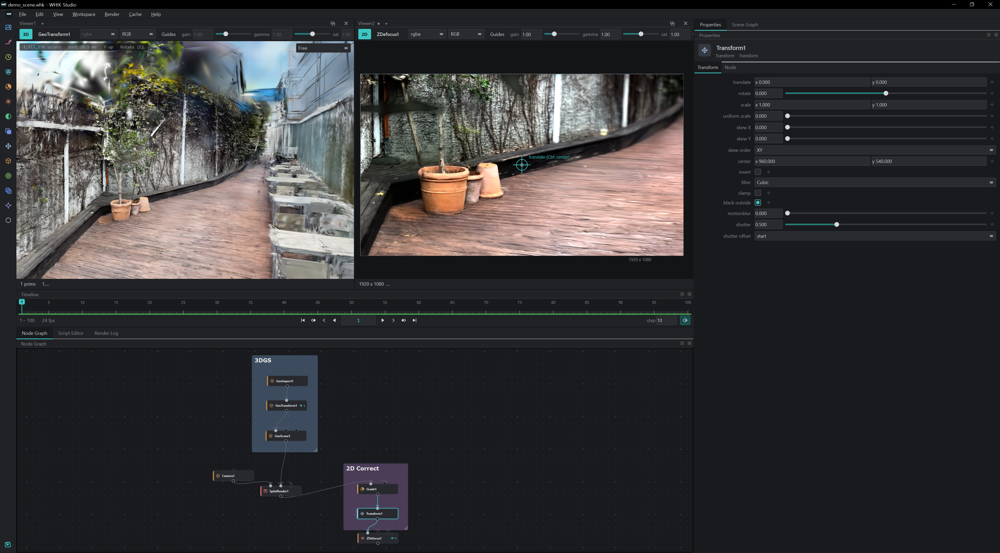
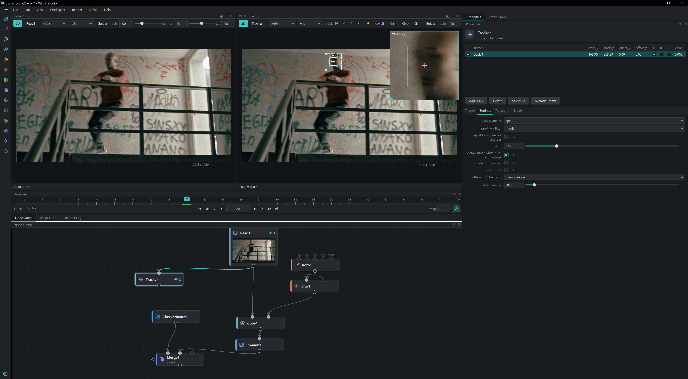
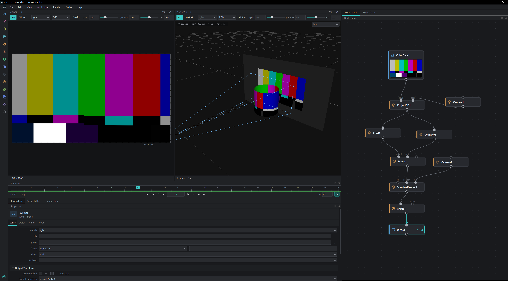

# WHIK Studio

**한국어** | [English](#english)

WHIK Studio는 노드 기반 영상 합성을 위한 무료 Windows 프로그램입니다. 3D 가우시안 스플랫(3DGS) 편집도 지원합니다.

> 아직 정식 버전이 아닌 미리 보기 버전이니 맛보기로 사용해 주세요. 매주 새 버전이 올라올 예정입니다.

*3D 가우시안 스플랫(3DGS) 장면 편집과 2D 합성 (GeoImport, SplatRender, Grade, ZDefocus)*

*트래킹과 로토, 채널 복사와 합성 (Tracker, Roto, Copy, Merge)*

*이미지 프로젝션과 3D 렌더 (Project3D, Card, Cylinder, ScanlineRender)*

## 다운로드

[**최신 버전 다운로드 (Releases)**](https://github.com/suin-park/Whik/releases/latest) → `WHIK-Studio-<버전>-Setup.exe`

## 설치

1. `WHIK-Studio-<버전>-Setup.exe`를 내려받아 실행합니다.
2. **"Windows의 PC 보호"** 창이 뜨면 **추가 정보 → 실행**을 누릅니다. 아직 코드 서명을 하지 않은 프로그램이라 나오는 안내입니다.
3. 설치가 끝나면 바탕화면의 **WHIK Studio** 아이콘을 더블 클릭해 실행합니다.

삭제는 Windows **설정 → 앱 → 설치된 앱**에서 WHIK Studio를 제거하면 됩니다.

## 시스템 요건

- Windows 10 / 11 (64비트)
- OpenGL 4.3을 지원하는 그래픽 카드 (최근 NVIDIA / AMD / Intel)
- 따로 설치할 것은 없습니다. Python, Qt, Visual C++ 런타임, ffmpeg가 함께 설치됩니다.

## 주요 기능

- 노드 기반 합성: Merge, Transform, Grade, Color, Filter, Channel, Time 노드
- 3D 가우시안 스플랫 장면 편집과 렌더링, 클래식 3D 지오메트리, Project3D
- Roto / RotoPaint, Tracker, CornerPin
- 이미지 시퀀스와 영상 읽기, 쓰기 (EXR, DPX, PNG, MOV/MP4 등), OCIO 색 관리
- Python 스크립트와 플러그인
- Prompt Editor: 원하는 기능을 말로 적으면 AI가 플러그인으로 만들어 줍니다

## Prompt Editor

필요한 기능을 평소 말투로 적어 보세요. 예를 들어 "밝은 부분만 번지게 하는 글로우 노드 만들어 줘"라고 쓰면, AI가 Python 플러그인으로 만들어 바로 쓸 수 있게 해 줍니다.

Claude, ChatGPT, Gemini 중에서 고를 수 있고, 각 서비스의 API 키는 본인 것을 넣어 사용합니다. 사용 요금은 본인 계정으로 청구되며, WHIK Lab은 따로 요금을 받지 않습니다.

**사용법**

1. Prompt Editor 탭을 엽니다 (Ctrl+Shift+I).
2. Claude, ChatGPT, Gemini 중 하나를 고르고, **API Key...** 버튼에서 본인의 API 키를 넣습니다. 키는 각 서비스 웹사이트에서 받을 수 있습니다.
   - Claude: console.anthropic.com
   - ChatGPT: platform.openai.com
   - Gemini: aistudio.google.com
3. 원하는 기능을 적고 보냅니다. AI가 코드를 만들고, 설치 전에 그 코드를 보여 줍니다. 확인을 눌러야 설치됩니다.
4. 설치된 기능은 노드 목록이나 **Plugins** 메뉴에 나타납니다. 마음에 들지 않으면 "이 부분 바꿔 줘"처럼 이어서 요청하면 됩니다.

**요금과 키**

- AI 사용 요금은 고른 서비스에서 본인 계정으로 청구됩니다. WHIK Lab에는 요금이 나가지 않습니다.
- API 키는 이 PC의 Windows 사용자 계정으로 암호화해서 저장합니다. 고른 AI 서비스에만 전송되고, WHIK Lab으로는 보내지 않습니다.
- 키를 지우려면 **API Key... → Remove API Key**를 누르세요.

**알아 두세요**

- AI가 만든 코드는 틀릴 수 있습니다. 결과가 이상하면 증상을 적어 다시 요청해 보세요.
- 인터넷 연결이 필요합니다.
- 설치된 플러그인은 **Plugins → Open Plugins Folder**에서 파일로 보고 지울 수 있습니다.

## 라이선스와 문의

- 개인 용도와 상업 용도 모두 무료로 사용할 수 있습니다. 자세한 내용은 [LICENSE.txt](LICENSE.txt)를 참고하세요.
- 포함된 서드파티 구성 요소와 라이선스는 설치 폴더의 `THIRD_PARTY_NOTICES.txt`와 `licenses` 폴더에 있습니다.
- 문의: support@whiklab.com, https://whik.co.kr

---

## English

WHIK Studio is a free Windows application for node-based video compositing. It also edits 3D Gaussian splats (3DGS).

> This is a preview, not an official release yet: please treat it as a first taste. New versions are planned every week.

Screenshots: 3DGS scene editing with 2D compositing, tracking and roto, image projection and 3D rendering (see above).

### Download

[**Download the latest version (Releases)**](https://github.com/suin-park/Whik/releases/latest) → `WHIK-Studio-<version>-Setup.exe`

### Install

1. Download and run `WHIK-Studio-<version>-Setup.exe`.
2. If **"Windows protected your PC"** appears, click **More info → Run anyway** (the program is not code-signed yet).
3. Double-click the **WHIK Studio** icon on the desktop.

To uninstall, remove WHIK Studio in Windows **Settings → Apps → Installed apps**.

### Requirements

- Windows 10 / 11 (64-bit)
- A GPU with OpenGL 4.3 (any recent NVIDIA / AMD / Intel)
- Nothing else to install: Python, Qt, the Visual C++ runtime and ffmpeg come with it.

### Prompt Editor

Describe a feature in plain words, for example "make a glow node that spreads only the bright parts", and an AI writes it as a Python plugin you can use right away.

Pick Claude, ChatGPT or Gemini and use your own API key for it. Usage is billed to your own account with that service; WHIK Lab charges nothing.

**How to use it**

1. Open the Prompt Editor tab (Ctrl+Shift+I).
2. Pick Claude, ChatGPT or Gemini and enter your API key with **API Key...**. Get a key from the service's website:
   - Claude: console.anthropic.com
   - ChatGPT: platform.openai.com
   - Gemini: aistudio.google.com
3. Describe what you want and send it. The AI writes the code and shows it to you first; it is installed only when you confirm.
4. The new feature appears in the node list or the **Plugins** menu. If it isn't quite right, ask again ("change this part").

**Billing and keys**

- AI usage is billed to your own account with the service you picked. Nothing is paid to WHIK Lab.
- Your API key is stored encrypted for your Windows user on this PC. It is sent only to the AI service you picked, never to WHIK Lab.
- To delete the key: **API Key... → Remove API Key**.

**Good to know**

- Code written by AI can be wrong. If something looks off, describe what happens and ask again.
- An internet connection is needed.
- Installed plugins are files you can see and delete in **Plugins → Open Plugins Folder**.

### Licence and contact

- Free for personal and commercial use; see [LICENSE.txt](LICENSE.txt).
- Third-party components and their licences are listed in `THIRD_PARTY_NOTICES.txt` and the `licenses` folder of the installation.
- Contact: support@whiklab.com, https://whik.co.kr

© 2026 Whik Lab
