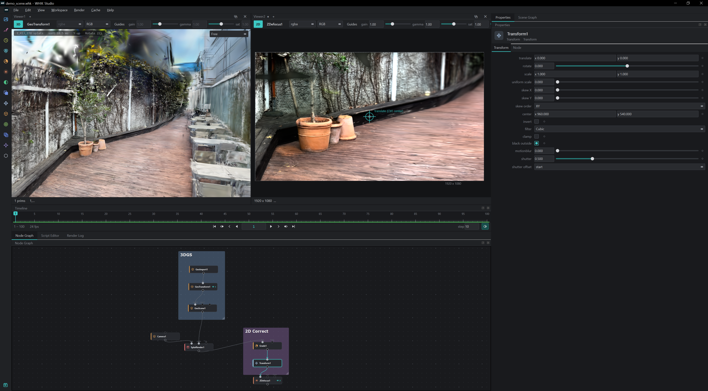
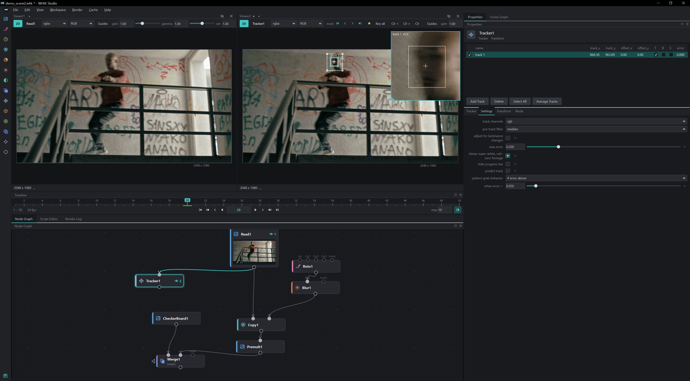
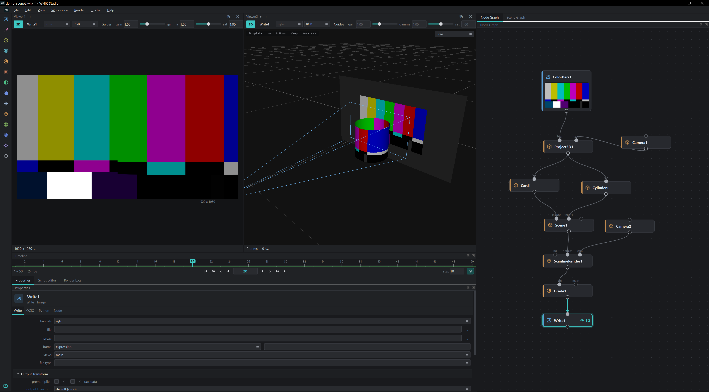

<p align="center"></p>

# WHIK Studio

**한국어** | [English](#english)

WHIK Studio는 노드 기반으로 영상을 합성하고 3D 장면을 만드는 무료 프로그램입니다. Windows와 리눅스에서 동작합니다. 키잉, 로토, 트래킹 같은 합성 작업부터 3D 가우시안 스플랫(3DGS)과 사실적인 3D 렌더, 내 PC에서 돌아가는 AI 노드까지 한 노드 그래프에서 다룹니다.


*3D 가우시안 스플랫(3DGS) 장면 편집과 2D 합성*


*트래킹과 로토, 채널 복사와 합성*


*이미지 프로젝션과 3D 렌더*

## 다운로드

[**최신 버전 다운로드 (Releases)**](https://github.com/suin-park/Whik/releases/latest)

- Windows: `WHIK-Studio-<버전>-Setup.exe`
- 리눅스: `WHIK-Studio-<버전>-x86_64.AppImage`

새 버전이 나오면 앱의 **도움말 > 업데이트 확인**에서 바로 받을 수 있습니다.

## 매뉴얼

처음 시작하기, 화면 구성, 단축키, 작업별 안내, 모든 노드의 옵션 설명을 [**whik.co.kr/manual**](https://whik.co.kr/manual)에서 볼 수 있습니다. 한국어, English, 日本語, 中文을 지원합니다.

## 주요 기능

**합성**
- 노드 기반 합성: Merge, Transform, Grade, ColorCorrect, 필터, 채널, 시간 노드, 그룹
- 키잉: ChromaKey, Despill, HairKey(머리카락까지 살리는 키), LevelKey
- 로토와 페인트, 메쉬 워프(GridWarp, CurveWarp, PuppetPin)
- 트래킹: 포인트와 평면 트래커, CornerPin, 카메라 트래커(촬영 카메라의 움직임과 렌즈 복원)
- 렌즈: 화면 속 직선으로 렌즈 왜곡 분석, 왜곡 되돌리기와 다시 입히기
- 필름 그레인: 실제 카메라와 필름의 입자 프리셋, 원본 영상의 그레인 측정
- 이미지 시퀀스와 영상 읽기, 쓰기(EXR, DPX, PNG, MOV, MP4 등), 크립토매트
- 색 관리: OCIO와 ACES, 뷰어에 보이는 그대로 저장

**3D**
- 3D 가우시안 스플랫 장면 편집과 렌더
- 3D 지오메트리와 모델링 도구, 재질과 UV 편집, Project3D
- Render3D: 빠른 GPU 렌더와 레이 트레이싱, 물리 기반 재질, 렌더 패스와 크립토매트
- 3D 파일 불러오기(USD, Alembic, GLB, FBX, OBJ 등), 무료 3D 모델 라이브러리
- 3D 프로그램과 실시간 연결: 3D 프로그램에서 작업하는 장면, 재질, 카메라, 렌더 패스가 그대로 따라옵니다(Windows, 리눅스)
- 3D 뷰 조작 방식을 쓰던 3D 프로그램과 같게 고를 수 있습니다

**AI 노드 (내 PC에서 실행, 계정 필요 없음)**
- 사물과 와이어 지우기, 자동 매트(Segment), 깊이 분석
- 업스케일, 프레임 보간
- 낮을 밤으로(DayToNight, LightSpill), 브러시로 칠하는 조명(LightPaint), 젖은 바닥과 그림자(Puddle, ShadowMaker)
- 창밖 바꾸기(WindowReplace), 표면에 붙이기(SurfaceStick)
- 얼굴: 나이 바꾸기(AgeShift), 얼굴 펼치기와 다시 입히기(FaceMap)
- 내 영상으로 나만의 AI 노드 학습(ModelTrainer)
- AI 노드는 도움말 > AI Pack에서 한 번 설치합니다(NVIDIA 그래픽 카드 필요)

**작업 환경**
- 렌더 대기열: 작업하면서 뒤에서 렌더
- 프로젝트 폴더: 소스와 결과를 한 폴더에 모아 다른 PC로 옮기기
- 단축키 편집, 한국어, 영어, 일본어, 중국어 화면
- 폰 카메라 실시간 연결(Windows)
- OFX 플러그인, Python 스크립트와 플러그인
- Prompt Editor: 원하는 기능을 말로 적으면 AI가 플러그인으로 만들어 줍니다
- AI 도우미 연결(MCP): AI 도우미가 노드를 만들고 고칠 수 있습니다

## 설치

**Windows**
1. `WHIK-Studio-<버전>-Setup.exe`를 내려받아 실행합니다.
2. **"Windows의 PC 보호"** 창이 뜨면 **추가 정보 → 실행**을 누릅니다. 아직 코드 서명을 하지 않은 프로그램이라 나오는 안내입니다.
3. 설치가 끝나면 시작 메뉴나 바탕화면의 **WHIK Studio**로 실행합니다.

삭제는 Windows **설정 → 앱 → 설치된 앱**에서 WHIK Studio를 제거하면 됩니다.

**리눅스**
1. `WHIK-Studio-<버전>-x86_64.AppImage`를 내려받습니다.
2. 실행 권한을 주고 엽니다. 설치는 필요 없습니다.
   ```
   chmod +x WHIK-Studio-<버전>-x86_64.AppImage
   ./WHIK-Studio-<버전>-x86_64.AppImage
   ```

## 시스템 요건

- Windows 10, 11 (64비트) 또는 64비트 리눅스(Ubuntu 22.04 이후, Rocky, AlmaLinux, RHEL 9 등)
- OpenGL 4.3을 지원하는 그래픽 카드(최근 NVIDIA, AMD, Intel)
- AI 노드: NVIDIA 그래픽 카드
- 따로 설치할 것은 없습니다. Python, Qt, ffmpeg가 함께 들어 있습니다.
- 리눅스에서는 폰 카메라 실시간 연결과 Go Live 방송이 아직 지원되지 않습니다.

## Prompt Editor

필요한 기능을 평소 말투로 적어 보세요. 예를 들어 "밝은 부분만 번지게 하는 글로우 노드 만들어 줘"라고 쓰면, AI가 Python 플러그인으로 만들어 바로 쓸 수 있게 해 줍니다.

Claude, OpenAI, Gemini 중에서 고를 수 있고, 각 서비스의 API 키는 본인 것을 넣어 사용합니다. 사용 요금은 본인 계정으로 청구되며, WHIK Lab은 따로 요금을 받지 않습니다.

**사용법**

1. Prompt Editor 탭을 엽니다 (Ctrl+Shift+I).
2. Claude, OpenAI, Gemini 중 하나를 고르고, **API Key...** 버튼에서 본인의 API 키를 넣습니다. 키는 각 서비스 웹사이트에서 받을 수 있습니다.
   - Claude: console.anthropic.com
   - OpenAI: platform.openai.com
   - Gemini: aistudio.google.com
3. 원하는 기능을 적고 보냅니다. AI가 코드를 만들고, 설치 전에 그 코드를 보여 줍니다. 확인을 눌러야 설치됩니다.
4. 설치된 기능은 노드 목록이나 **Plugins** 메뉴에 나타납니다. 마음에 들지 않으면 "이 부분 바꿔 줘"처럼 이어서 요청하면 됩니다.
5. 대화는 왼쪽 목록에 남습니다. 눌러서 다시 보거나 이어서 물을 수 있고, **Delete**(또는 우클릭)로 지울 수 있습니다. 대화 기록은 이 PC에만 저장됩니다.

**요금과 키**

- AI 사용 요금은 고른 서비스에서 본인 계정으로 청구됩니다. WHIK Lab에는 요금이 나가지 않습니다.
- API 키는 이 PC의 사용자 계정으로 암호화하거나(Windows) 본인만 읽을 수 있는 파일로(리눅스) 저장합니다. 고른 AI 서비스에만 전송되고, WHIK Lab으로는 보내지 않습니다.
- 키를 지우려면 **API Key... → Remove API Key**를 누르세요.

**알아 두세요**

- AI가 만든 코드는 틀릴 수 있습니다. 결과가 이상하면 증상을 적어 다시 요청해 보세요.
- 인터넷 연결이 필요합니다.
- 설치된 플러그인은 **Plugins → Open Plugins Folder**에서 파일로 보고 지울 수 있습니다.

## 라이선스와 문의

- 개인 용도와 상업 용도 모두 무료로 사용할 수 있습니다. 자세한 내용은 [LICENSE.txt](LICENSE.txt)를 참고하세요.
- 포함된 서드파티 구성 요소와 라이선스는 설치 폴더의 `THIRD_PARTY_NOTICES.txt`와 `licenses` 폴더에 있습니다.
- 문의: support@whiklab.com, https://whik.co.kr

---

<a id="english"></a>

## English

WHIK Studio is a free application for node-based video compositing and 3D, for Windows and Linux. Keying, roto and tracking, 3D Gaussian splats (3DGS) and realistic 3D rendering, and AI nodes that run on your own PC, all in one node graph.

Screenshots (above): 3DGS scene editing with 2D compositing, tracking and roto, image projection and 3D rendering.

### Download

[**Download the latest version (Releases)**](https://github.com/suin-park/Whik/releases/latest)

- Windows: `WHIK-Studio-<version>-Setup.exe`
- Linux: `WHIK-Studio-<version>-x86_64.AppImage`

New versions come straight from **Help > Check for Updates** in the app.

### Manual

Getting started, the screen, shortcuts, guides by task and every node's options at [**whik.co.kr/manual**](https://whik.co.kr/manual), in Korean, English, Japanese and Chinese.

### Features

**Compositing**
- Node-based compositing: Merge, Transform, Grade, ColorCorrect, filter, channel and time nodes, groups
- Keying: ChromaKey, Despill, HairKey (keeps fine hair), LevelKey
- Roto and paint, mesh warps (GridWarp, CurveWarp, PuppetPin)
- Tracking: point and planar trackers, CornerPin, a camera tracker (the shot's camera move and lens solved)
- Lens: distortion analysed from straight lines in the picture, undistort and distort again
- Film grain: presets from real cameras and film stocks, the plate's own grain measured
- Image sequences and video in and out (EXR, DPX, PNG, MOV, MP4...), Cryptomatte
- Colour management: OCIO and ACES, written as the viewer shows it

**3D**
- 3D Gaussian splat scene editing and rendering
- 3D geometry and modelling tools, materials and UV editing, Project3D
- Render3D: fast GPU rendering and ray tracing, physically based materials, render passes and Cryptomatte
- 3D files in (USD, Alembic, GLB, FBX, OBJ...), a library of free 3D models
- Live link with 3D programs: the scene you build in a 3D program, its materials, camera and render passes follow as you work (Windows, Linux)
- The 3D view's mouse and keys can work like the 3D program you know

**AI nodes (run on your PC, no account)**
- Object and wire removal, automatic mattes (Segment), depth
- Upscaling, frame interpolation
- Day to night (DayToNight, LightSpill), light painted with a brush (LightPaint), wet ground and shadows (Puddle, ShadowMaker)
- Replace the view out of windows (WindowReplace), stick things to surfaces (SurfaceStick)
- Faces: age (AgeShift), unwrap and apply back (FaceMap)
- Train an AI node of your own from your footage (ModelTrainer)
- Install the AI nodes once from Help > AI Pack (needs an NVIDIA graphics card)

**Workflow**
- Render queue: render in the background while you work
- Project folders: sources and results in one folder, moved to another PC as it is
- Keyboard shortcut editor; the interface in Korean, English, Japanese and Chinese
- Live phone camera (Windows)
- OFX plugins, Python scripts and plugins
- Prompt Editor: describe a feature and an AI makes it a plugin
- AI assistant link (MCP): an AI assistant can make and change nodes

### Install

**Windows**
1. Download and run `WHIK-Studio-<version>-Setup.exe`.
2. If **"Windows protected your PC"** appears, click **More info → Run anyway** (the program is not code-signed yet).
3. Open **WHIK Studio** from the Start menu or the desktop.

To uninstall, remove WHIK Studio in Windows **Settings → Apps → Installed apps**.

**Linux**
1. Download `WHIK-Studio-<version>-x86_64.AppImage`.
2. Make it executable and open it; nothing to install.
   ```
   chmod +x WHIK-Studio-<version>-x86_64.AppImage
   ./WHIK-Studio-<version>-x86_64.AppImage
   ```

### Requirements

- Windows 10 / 11 (64-bit) or 64-bit Linux (Ubuntu 22.04 and later, Rocky, AlmaLinux, RHEL 9...)
- A GPU with OpenGL 4.3 (any recent NVIDIA, AMD, Intel)
- AI nodes: an NVIDIA graphics card
- Nothing else to install: Python, Qt and ffmpeg come with it.
- On Linux, the live phone camera and Go Live are not available yet.

### Prompt Editor

Describe a feature in plain words, for example "make a glow node that spreads only the bright parts", and an AI writes it as a Python plugin you can use right away.

Pick Claude, OpenAI or Gemini and use your own API key for it. Usage is billed to your own account with that service; WHIK Lab charges nothing.

**How to use it**

1. Open the Prompt Editor tab (Ctrl+Shift+I).
2. Pick Claude, OpenAI or Gemini and enter your API key with **API Key...**. Get a key from the service's website:
   - Claude: console.anthropic.com
   - OpenAI: platform.openai.com
   - Gemini: aistudio.google.com
3. Describe what you want and send it. The AI writes the code and shows it to you first; it is installed only when you confirm.
4. The new feature appears in the node list or the **Plugins** menu. If it isn't quite right, ask again ("change this part").
5. Your conversations stay in the list on the left: open one to read it again or go on, **Delete** (or right-click) removes it. They are kept only on this PC.

**Billing and keys**

- AI usage is billed to your own account with the service you picked. Nothing is paid to WHIK Lab.
- Your API key is stored encrypted for your user on this PC (Windows) or in a file only you can read (Linux). It is sent only to the AI service you picked, never to WHIK Lab.
- To delete the key: **API Key... → Remove API Key**.

**Good to know**

- Code written by AI can be wrong. If something looks off, describe what happens and ask again.
- An internet connection is needed.
- Installed plugins are files you can see and delete in **Plugins → Open Plugins Folder**.

### Licence and contact

- Free for personal and commercial use; see [LICENSE.txt](LICENSE.txt).
- Third-party components and their licences are listed in `THIRD_PARTY_NOTICES.txt` and the `licenses` folder of the installation.
- Contact: support@whiklab.com, https://whik.co.kr

© 2026 Whik Lab
