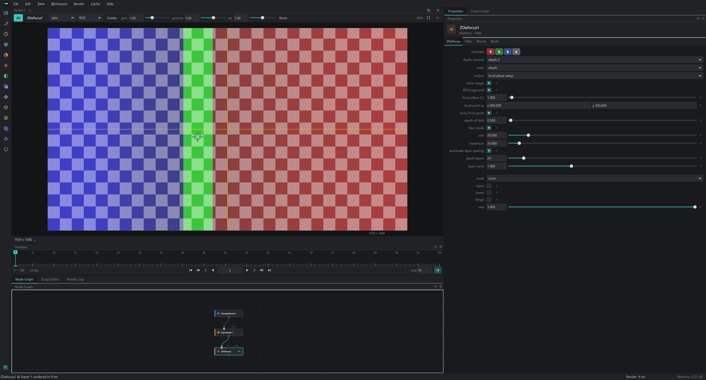

# WHIK Studio

**한국어** | [English](#english)

WHIK Studio는 노드 기반 영상 합성을 위한 무료 Windows 프로그램입니다. 3D 가우시안 스플랫(3DGS) 편집도 지원합니다.

> 아직 정식 버전이 아닌 미리 보기 버전이니 맛보기로 사용해 주세요. 매주 새 버전이 올라올 예정입니다.

## 다운로드

[**최신 버전 다운로드 (Releases)**](https://github.com/suin-park/Whik/releases/latest) → `WHIK-Studio-<버전>-Setup.exe`

## 설치

1. `WHIK-Studio-<버전>-Setup.exe`를 내려받아 실행합니다.
2. **"Windows의 PC 보호"** 창이 뜨면 **추가 정보 → 실행**을 누릅니다. 아직 코드 서명을 하지 않은 프로그램이라 나오는 안내입니다.
3. 설치가 끝나면 바탕화면의 **WHIK Studio** 아이콘을 더블 클릭해 실행합니다.

삭제는 Windows **설정 → 앱 → 설치된 앱**에서 WHIK Studio를 제거하면 됩니다.

## 시스템 요건

- Windows 10 / 11 (64비트)
- OpenGL 4.3을 지원하는 그래픽 카드 (최근 NVIDIA / AMD / Intel)
- 따로 설치할 것은 없습니다. Python, Qt, Visual C++ 런타임, ffmpeg가 함께 설치됩니다.

## 주요 기능

- 노드 기반 합성: Merge, Transform, Grade, Color, Filter, Channel, Time 노드
- 3D 가우시안 스플랫 장면 편집과 렌더링, 클래식 3D 지오메트리, Project3D
- Roto / RotoPaint, Tracker, CornerPin
- 이미지 시퀀스와 영상 읽기, 쓰기 (EXR, DPX, PNG, MOV/MP4 등), OCIO 색 관리
- Python 스크립트

## 라이선스와 문의

- 개인 용도와 상업 용도 모두 무료로 사용할 수 있습니다. 자세한 내용은 [LICENSE.txt](LICENSE.txt)를 참고하세요.
- 포함된 서드파티 구성 요소와 라이선스는 설치 폴더의 `THIRD_PARTY_NOTICES.txt`와 `licenses` 폴더에 있습니다.
- 문의: support@whiklab.com, https://whik.co.kr

---

## English

WHIK Studio is a free Windows application for node-based video compositing. It also edits 3D Gaussian splats (3DGS).

> This is a preview, not an official release yet: please treat it as a first taste. New versions are planned every week.

### Download

[**Download the latest version (Releases)**](https://github.com/suin-park/Whik/releases/latest) → `WHIK-Studio-<version>-Setup.exe`

### Install

1. Download and run `WHIK-Studio-<version>-Setup.exe`.
2. If **"Windows protected your PC"** appears, click **More info → Run anyway** (the program is not code-signed yet).
3. Double-click the **WHIK Studio** icon on the desktop.

To uninstall, remove WHIK Studio in Windows **Settings → Apps → Installed apps**.

### Requirements

- Windows 10 / 11 (64-bit)
- A GPU with OpenGL 4.3 (any recent NVIDIA / AMD / Intel)
- Nothing else to install: Python, Qt, the Visual C++ runtime and ffmpeg come with it.

### Licence and contact

- Free for personal and commercial use; see [LICENSE.txt](LICENSE.txt).
- Third-party components and their licences are listed in `THIRD_PARTY_NOTICES.txt` and the `licenses` folder of the installation.
- Contact: support@whiklab.com, https://whik.co.kr

© 2026 Whik Lab
